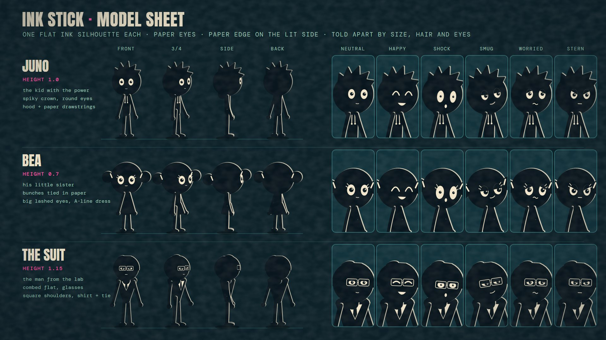
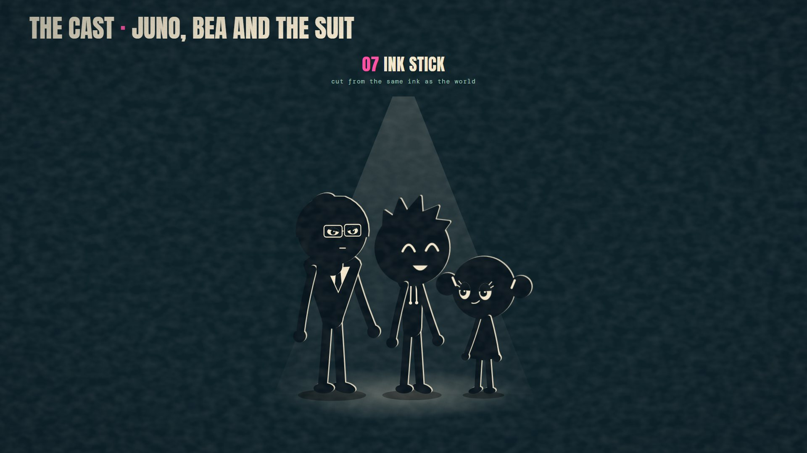
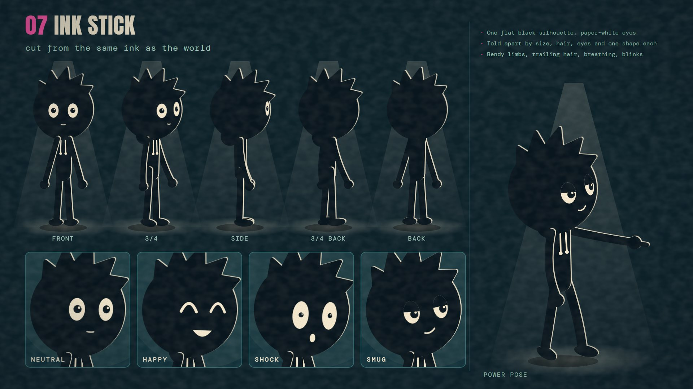
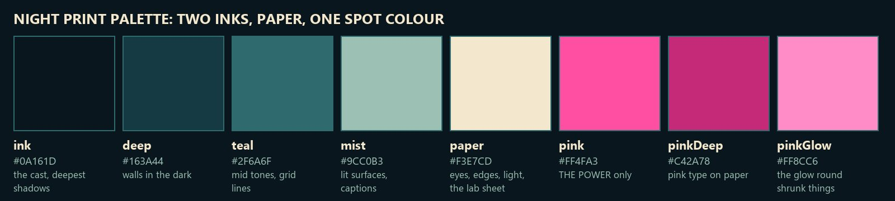
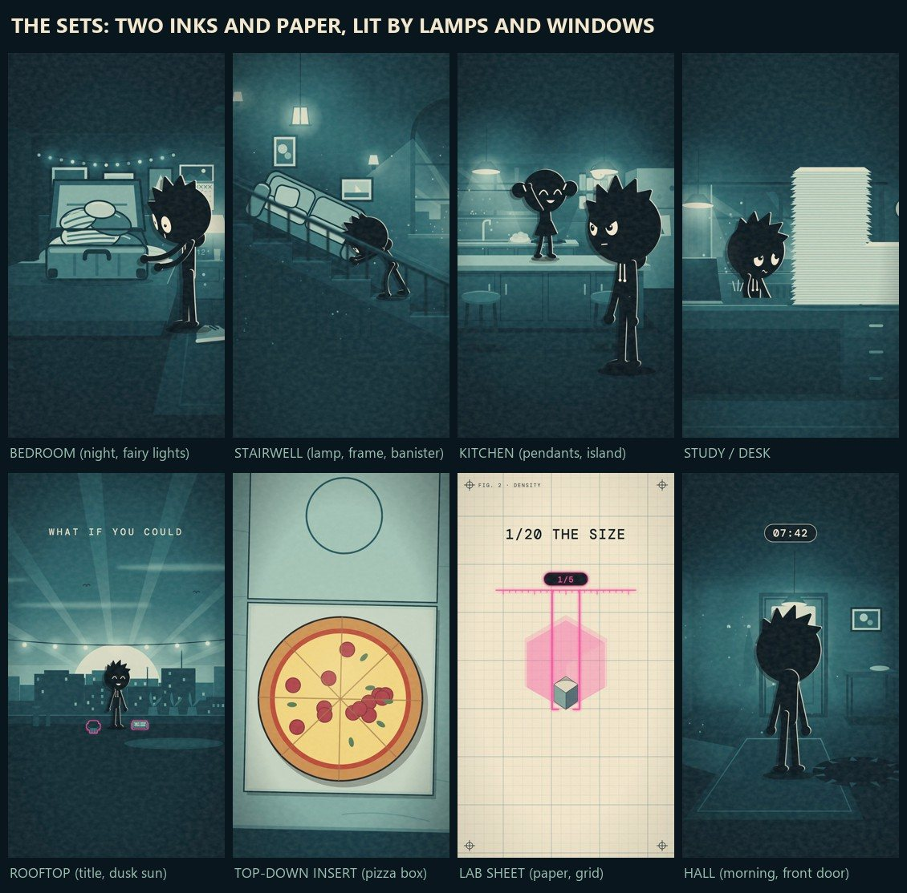
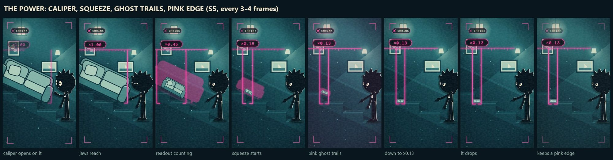
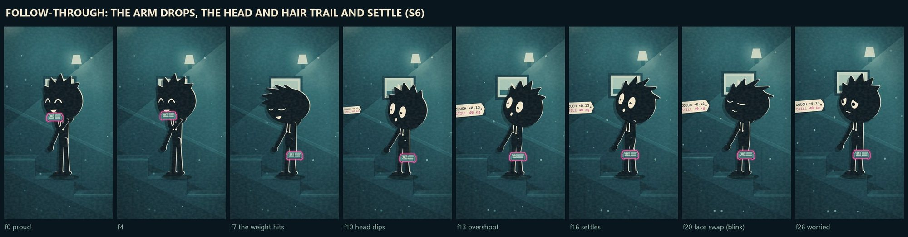
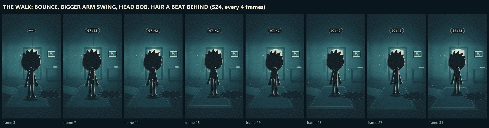
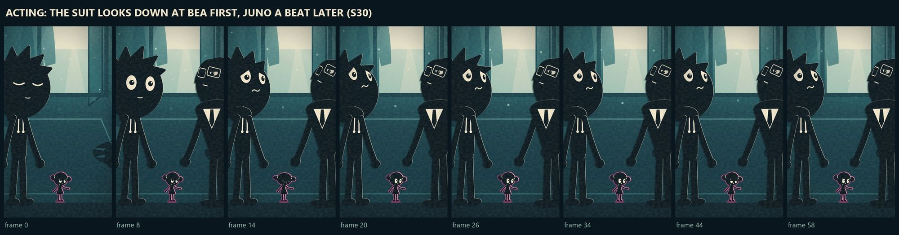
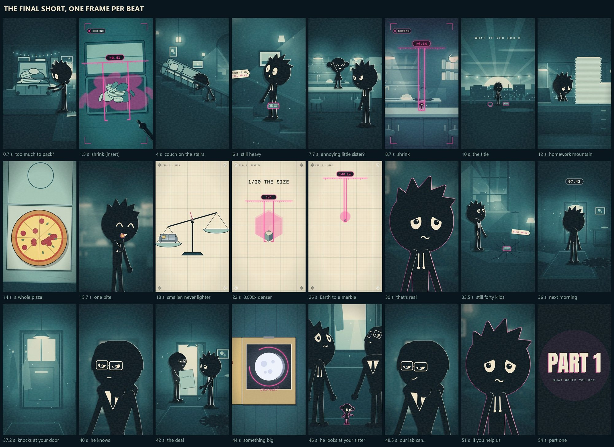

# The house look: Ink Stick on Night Print

The skill's default look, set on 11 November 2026 with the `shrink60` example (*What if you could shrink anything?*,
a 56.5 s vertical Short: render `Shrink60Stick`). Everything a new episode needs to look, move and sound the same: the
cast, the world, the power, the animation and the mix, with the exact numbers the code uses. To draw it, import from
`src/kit/ink.tsx` (see `kit.md`).



---

## 1. The look in one paragraph

A night-time world printed in **two inks on paper** (deep teal and near-black on a warm cream), lit by lamps and
windows, with one fluorescent **pink** that belongs only to the power. The cast are **stick figures cut from the same
ink**: one flat black silhouette each, paper-white eyes, a thin paper edge on the side facing the light and a hard
cut-card shadow, exactly like every other paper cut-out in the world. They have no skin colour and no shading; you
tell them apart by **size, hair, eyes and voice**. The world moves slowly. The characters move a lot more: bendy
limbs, hair and heads that trail every move and overshoot, breathing, blinks and squash.

### The rules

1. **Two inks and paper.** Every set is printed through the same gradient map (section 3). No other colours, except the
   pizza and the moon folder (story props kept in full colour on purpose so they read as the hero object).
2. **Pink is the power, and nothing else.** The caliper, the readout, the ghost trails, the glow round shrunk things,
   the flash on each shrink, the end card. Never on a costume or a set.
3. **The cast is ink.** Flat `#0A161D` silhouettes. Features in paper `#F3E7CD`. No skin tone, no gradients, no
   outlines other than the paper edge.
4. **One telling shape each.** Juno's hood and strings, Bea's bunches and dress, the suit's square shoulders, shirt,
   tie and glasses. If a silhouette alone can't tell you who it is, add size or hair before adding detail.
5. **Characters move more than the world.** Sets drift, dust floats, lamps glow; the cast never fully stops (section 6).
6. **Flat means flat.** Limbs never shrink into stubs by pointing at the camera; arms join the body inside its outline;
   heads are always drawn in front of their own body (section 6.5).

---

## 2. The cast



### 2.1 How every character is built

| Part | Drawn as | Juno's numbers (model units) |
|---|---|---|
| Silhouette | one flat ink shape, `#0A161D` | |
| Head | a circle, radius = 1.06 × the head radius | R = 84.8 |
| Torso | a tapered capsule from just below the hips to the neck; it narrows as the body turns | half-width 21 at the hips, 24 at the chest |
| Neck | a thick stroke drawn with the head, under it | 0.7 × the chest half-width |
| Arms, legs | one curved stroke each, shoulder to wrist or hip to ankle (rubber hose: they bend, never kink) | arms 15 wide, legs 17.5 wide |
| Hands | round mitts; pointing adds one short thick finger | radius 12.6 |
| Feet | ovals that turn with the toe direction | |
| Shoulders, hips | just inside the body outline | shoulders at 0.7 × chest half-width, hips at 0.42 × hip half-width |
| Paper edge | the silhouette offset toward the light (up and right) in paper, under the ink | about 2.6 units, scaled so it reads the same at any size |
| Cast shadow | hard ink offset down-left, 42% (the world's own `npDrop`) | dx -9, dy 8 |
| Ground shadow | a soft black ellipse at the feet, 38% | 134 wide, 23 tall |
| Shrunk | a glowing pink edge round the whole figure (`npMarked`) | |

Every part gets its own paper edge, so an arm in front of the body is separated from it by a thin light line, the
way layered paper cut-outs are.

### 2.2 The three characters

| | **Juno** | **Bea** | **The suit** |
|---|---|---|---|
| Role | the kid with the power (the "you" of the narration) | his little sister | the man from the lab |
| Height | 1.0 | 0.7 (head 0.84, so it reads big: a child) | 1.15 (head 0.92) |
| Hair | a crown of five spikes, swinging a beat behind the head | two round bunches tied with paper bands; they bounce | combed flat on top with a forelock on the parting side |
| Eyes | round, medium, a catchlight in each pupil | bigger and rounder, two paper lashes each | narrow, heavy-lidded, behind paper-frame glasses |
| Telling shape | the hood bunched at the back of the neck; two paper drawstrings on the chest | an A-line dress over the hips | square jacket shoulders, a paper shirt V and an ink tie |
| Default face | neutral | happy | stern |
| Voice | the narrator speaks for him ("you") | none (giggles and squeaks in the effects) | his own: ElevenLabs "Daniel", deep, calm, formal |

### 2.3 Faces

Eyes are paper ovals with ink pupils; expressions come from **ink lids cut across the eye**, not brows. The mouth is a
small paper mark, shown only when the face needs one.

| Expression | Eyes | Mouth |
|---|---|---|
| neutral | open | a short soft line |
| happy | upturned paper arcs (no whites) | an open paper grin |
| shock | 1.22 × taller, pupils 0.62 × smaller | a paper "o" |
| smug | lids 48% down, nearly level | a one-sided smirk |
| worried | lids 28% down, slanting up toward the middle | a wavy line |
| stern | lids 36% down, slanting down toward the middle | a flat line |

* Pupils follow the `look` direction (where the character is looking); a lowered lid also lowers the pupil.
* **Blinks:** every character blinks on their own every 104 frames (about 3.5 s), each on a different beat, a 4-frame
  blink. A closed eye is a paper curve.
* **Changing face** always happens through a blink (2 frames either side), and the head pops with it: 5% wider, 6%
  shorter for those frames.

### 2.4 Turning

* The face slides toward the side the head is turned to; the far eye squashes and disappears past three-quarters.
* Seen from behind there is no face at all; hair and the hood still read.
* The suit's far lens, once it's nearly edge-on, shows as an empty frame.



---

## 3. The world: Night Print



| Name | Hex | Used for |
|---|---|---|
| ink | `#0A161D` | the cast, the deepest shadows |
| deep | `#163A44` | walls in the dark |
| teal | `#2F6A6F` | mid tones, grid lines, frames |
| mist | `#9CC0B3` | lit surfaces, captions |
| paper | `#F3E7CD` | eyes, paper edges, light, the lab sheet |
| pink | `#FF4FA3` | **the power only** |
| pink deep | `#C42A78` | pink type on paper |
| pink glow | `#FF8CC6` | the glow round shrunk things |

### 3.1 How a set is printed

* **Gradient map (`npPrint`).** Each set is drawn in ordinary colours, then printed: lifted a touch (gamma 0.78),
  turned to brightness, and mapped onto five even stops: ink, deep, teal, mist, paper. So the dark rooms sit in
  deep teal rather than black, and anything lit goes to mist and paper.
* **Cut card.** Props and figures are paper cut-outs: a paper edge on the lit side and a hard ink shadow on the other
  (`npCutR`: paper edge dx 3.5, dy -1.5; ink shadow dx -10, dy 9 at 55%).
* **Finish (`PaperFinish`, on every shot).** A vignette set per shot (soft on the paper lab sheet, deeper in rooms), a
  paper mottle (fractal noise), and a fine halftone dot multiplied over everything (7%).
* **Light.** Every room has its own sources: lamps, pendant lights, fairy lights, windows (night blue, morning
  cream), with soft cones, pools on the floor and floating dust.

### 3.2 The sets



| Set | Where | What makes it |
|---|---|---|
| Bedroom | the packing gag | night, fairy lights, the suitcase on the bed |
| Stairwell | the couch gag, the floor breaking | wall lamp, framed picture, banister, the slope of the stairs |
| Kitchen | Bea on the counter | pendant lamps, the island, shelves, the window |
| Study / desk | homework mountain | desk lamp, the paper stack |
| Rooftop | the title card | dusk sun, city skyline, string lights, rays |
| Top-down inserts | the suitcase, the pizza box | flat, seen from above, the caliper across them |
| Lab sheet | the science | paper with a fine grid, crosshair corners, "FIG." labels, type in DM Mono |
| Hall | next morning, the suit | front door with its window light, rug, side table, the hole in the floor |

### 3.3 Type

| Font | Used for |
|---|---|
| **Anton** | titles ("WHAT IF YOU COULD / SHRINK ANYTHING?", "PART 1"), numbers on the lab sheet |
| **DM Mono** | readouts (×0.13), labels, tags, the clock chip, captions |
| **Caveat** | handwritten notes |

---

## 4. The power: shrink



1. **The caliper.** Pink jaws on a ruler open over the thing, with a readout pill (×1.00) above.
2. **The squeeze.** The jaws close and the readout counts down; the thing squeezes to size with **pink ghost trails**.
3. **The mark.** Anything shrunk keeps a **thin glowing pink edge** for the rest of the episode, so a tiny thing still
   reads (the toy couch, mouse-sized Bea).
4. **The flash.** A pink flash (about 20%) on every shrink.
5. **The tag.** A paper specimen tag swings in on a string: "COUCH ×0.13 / STILL 40 kg", in DM Mono with the last line
   in pink deep.
6. **The overlay.** On every shrink shot there are pink corner brackets and a blinking SHRINK chip at the top left. Keep
   readouts clear of that chip.

**The rule:** anything you point at shrinks to any size, but it gets **smaller, never lighter**.

---

## 5. Camera and framing

* **1080 × 1920 vertical**, 30 fps. Each shot is framed by a camera centre and zoom (`camV`).
* Moves are slow push-ins (2–10% over a shot) with the odd small drift; no fast pans.
* Wides are about 1.4–2× zoom, mediums 2–2.7×, and close-ups put the head at 4.6–5.4× its size against a blurred
  copy of the set.
* Inserts are flat and top-down.
* **Safe areas:** keep labels and readouts below the SHRINK chip (top-left, about y 150–230) and away from the right
  edge and bottom quarter, where YouTube's buttons and captions sit.
* **Eyelines:** characters look at what the narration is about. When the line is "he looks at your sister", the suit's
  head goes down to Bea first and Juno's follows a beat later.

---

## 6. Animation style

**The idea:** the world is printed and slow; the characters are alive. Every pose is keyed and eased like any 2D
animation, and the rig adds the life a drawn character has, so nothing is ever a frozen pose.

### 6.1 Keys

Poses are keyed on frames with eased in-betweens (cubic ease in and out, or ease-out for snaps); faces swap at their
key. Contact poses (hands on the suitcase lid, the couch in the hand, the pizza to the mouth) are keyed exactly, and
props are pinned to the hand wherever it is drawn.

### 6.2 Follow-through (the springs)

Loose parts are springs chasing the pose over the last second of motion: they lag, overshoot and settle.

| Part | What chases what | Spring (per frame) |
|---|---|---|
| Head nod | body lean + head nod | ω 0.34, damping 0.30 |
| Head tilt | body tilt + head tilt | ω 0.34, damping 0.30 |
| Body lean and tilt | itself (60% of the overshoot) | ω 0.42, damping 0.34 |
| Elbows | the arm swing; the forearm whips through | ω 0.30, damping 0.32, 0.8 × into the elbow bend |
| Hair, bunches | head and body together, 1.6 × | ω 0.22, damping 0.20 (slow and loose) |
| Squash | the squash itself (a jelly bounce on landings) | ω 0.50, damping 0.24 |



### 6.3 Life in the holds

| | How much | How often |
|---|---|---|
| Breathing | the head nods 1.6° | about 1.9 s a breath |
| Idle sway | lean 1.2°, tilt 1.0°, head tilt 1.4° | about 2.9 s |
| Hair drift | 3° | about 1.5 s |
| Blinks | 4 frames | every 3.5 s, offset per character |
| Squash | every keyed squash × 1.4, plus the jelly spring | on every landing |

Each character's cycles start on a different beat, so a two-shot never breathes in sync.

### 6.4 Walks

The walk keys swing legs and arms in opposition. On top of that, the body leans into it by 5°, arm swing is 1.4 ×
bigger, the head bobs 3.5° on every step, the body bounces (squash 0.04 on each step), and the hair swings a beat behind.



### 6.5 Drawing a 3D pose flat (the rules that fixed the "broken skeleton")

The shots are posed with a joint skeleton, then laid out flat. Four rules keep a flat figure readable:

1. **Limbs keep their length.** A segment is never drawn shorter than 80% of its length; one aimed nearly at the camera
   (under 35% of its length on screen) hangs down and out instead of pointing nowhere.
2. **Limbs join the body inside its outline:** shoulders at 0.7 × the chest half-width, hips at 0.42 × the hip
   half-width. Nothing hangs from thin air, and no hip knobs show.
3. **Draw order comes from the turn alone, never from the camera's tilt.** A low camera must not put a head behind
   its own body.
4. **The neck belongs to the head** and is drawn under it, so it can never cross the face.

After flattening, the figure is stood back on its lowest foot so it never sinks into the floor.



### 6.6 Timing

* About **35 cuts a minute** overall and faster in the cold open; shots run 0.8–3.9 s.
* Every "Shrink." beat is about 0.8 s: the caliper lands, squeezes and flashes inside it.
* Reactions read in two steps: the face changes first (through a blink), then the body follows through.

---

## 7. Sound and voice

| Track | What | Settings |
|---|---|---|
| Narrator | the whole script, in the second person | ElevenLabs voice `TX3LPaxmHKxFdv7VOQHJ`, `eleven_multilingual_v2`, stability 0.40, similarity 0.80, style 0.35, speaker boost |
| The suit | his two quoted lines: "Our lab can make her big again…" / "If you help us." | ElevenLabs "Daniel" `onwK4e9ZLuTAKqWW03F9`, stability 0.55, similarity 0.80, style 0.18, set in `episode.json` `cast_voices`. The skill's `castvoice.py` fits each line into the narrator's own slot and matches his level (`public/shrink60/voice-cast.wav`); the narrator keeps "he says." |
| Effects | 31 clips (caliper clamp, shrink zip, couch thud, floor break, door knocks, belly boing, giggle, squeak, boom…) | generated with ElevenLabs, cached in `library/sfx/`; 3 LU under the voice |
| Music | a low bed under the cold open and the fun part, out at the science (S17) | 9.5 LU under the voice |
| Master | the full mix | -14 LUFS integrated, true peak -1.4 dBTP |

The pauses in the narration are set by type: 0.16 s between words, 0.34 s at a comma, 0.48 s at a full stop, 0.62 s
after a question, with longer beats where the story turns (up to 1.0 s before "What would you do?"). Hits are placed
in those pauses to keep them off the words; the title boom is the one deliberate exception.

---

## 8. The episode



The seven-beat What If formula, in 56.4 s and 34 shots (full shot list: `out/shrink60/shotlist.md`).

| Beat | Lines |
|---|---|
| 1. Cold open: three quick demos | "Too much to pack? Shrink. It all fits." "Couch stuck on the stairs? Shrink. Still heavy." "Annoying little sister? Shrink. Uh oh." |
| 2. The premise | "What if you could shrink anything?" (rooftop title card) |
| 3. The fun part | "Homework mountain? Shrink. A whole pizza? Shrink. One bite. Still every calorie." |
| 4. The catch, and the real science | "Things get smaller, never lighter… a twentieth of its size… eight thousand times denser… the Earth… a marble… a black hole. That's real." Then: "And that toy couch? Still forty kilos. The floor gives way." |
| 5. Someone powerful notices | "Next morning, a man in a suit knocks at your door… he wants you to shrink something for him. Something big." (a folder with the Moon circled) |
| 6. A choice with family at stake | "Then he looks at your sister, still mouse-sized. 'Our lab can make her big again,' he says. 'If you help us.'" |
| 7. Cliffhanger | "What would you do? Part one." |

### The science, checked

| Claim | Working | Source |
|---|---|---|
| 1/20 the size → 8,000 × denser | the mass stays, every length × 1/20, so the volume × (1/20)³ = 1/8,000, and density = mass / volume | density = mass / volume; volume scales with the cube of length |
| The Earth at 16 mm is a black hole | r = 2GM/c² = 2 × 6.674e-11 × 5.972e24 / (2.998e8)² = 8.87 mm (17.7 mm across); a 16 mm marble is inside it | Schwarzschild radius; Earth's mass from the NASA Earth Fact Sheet; G and c from CODATA 2018 |
| The shrunk pizza keeps every calorie | the power keeps all the matter, and food energy is chemical energy in that matter | the episode's rule |
| The toy couch is still 40 kg | story fact (a light two-seat couch) | story |

---

## 9. The other looks in the example

`shrink60` builds the same Short five ways, one composition each: `Shrink60Stick` (the house look), and the 3D
directions tried on the way there, `Shrink60Cel` (three-tone toon), `Shrink60Fold` (low-poly facets), `Shrink60Plush`
(felt and stitches) and `Shrink60Paint` (flat 2D with painted light). They share the timeline, the voice and the sound;
only the cast's rendering changes (`StyleKey` in `shots.tsx`). Keep them for reference: the person who set the house look
chose Ink Stick over all four, so don't offer them as the default.

The run cost 1,253 ElevenLabs credits: 842 for the voice, 362 for 7 new effects (the rest came from the library) and
49 for the suit's two lines.

## 10. Making the next one

**Where things live**

| What | File |
|---|---|
| The stick rig: drawing, faces, hair, life, flat layout | `src/designs/stick.tsx` |
| Poses, keys and the follow-through springs (`pose3At`, `face3At`) | `src/designs/juno3d.tsx` |
| The cast definitions (`STICK`, and Bea and the suit via `castFor`) and the design sheets | `src/designs/CharacterDesigns.tsx` |
| The world: palette, print, cut-card, finish, caliper, squeeze, tags | `src/episodes/shrink/style.tsx` |
| The 34 shots | `src/episodes/shrink60/shots.tsx` |
| The props and the hall | `src/episodes/shrink60/props60.tsx` |
| The versions and the suit's voice track | `src/episodes/shrink60/index.tsx` |
| The one-import kit for new episodes | `src/kit/ink.tsx` |
| Script, science, sound and edit | `src/episodes/shrink60/episode.json` |

**Commands** (from the studio folder)

```bash
python <skill>/scripts/castvoice.py <slug>
```

```bash
npx remotion still src/index.ts Designs out/model-sheet.png --frame=11
```

```bash
python <skill>/scripts/master.py shrink60
```

1. `castvoice.py` gives the characters who speak their own voices (`cast_voices` in `episode.json`, see `sound.md`).
2. The model sheet is frame 11 of the design sheets; frames 9 and 10 are the Ink Stick design and cast pages.
3. `master.py` renders the composition named by `id` in `episode.json`: `Shrink60Stick` in the example. Set it to
   another version's composition to render that one.

**To cast a new character:** add a `who` to `src/designs/stick.tsx` (their hair, eyes and one telling shape; `EYES`
holds the eye settings) and a branch in `castFor` (`src/designs/juno3d.tsx`) for their height, body and default colours,
then add them to `INK_CAST` in `src/kit/ink.tsx` and the model sheet. Give them their own voice if they speak. Check
them on the model sheet from the front, three-quarter, side and back before animating, and check that nothing about
them resembles a famous character.
